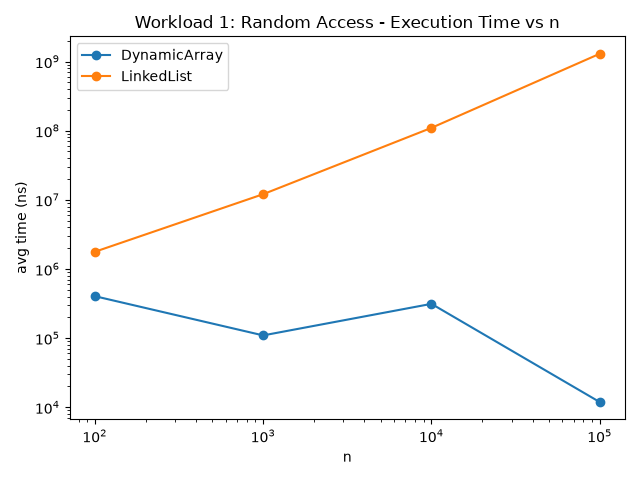
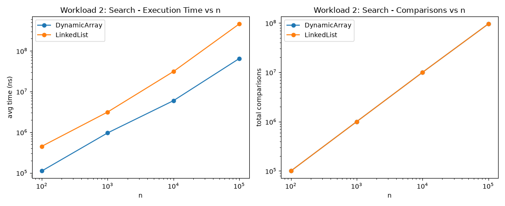
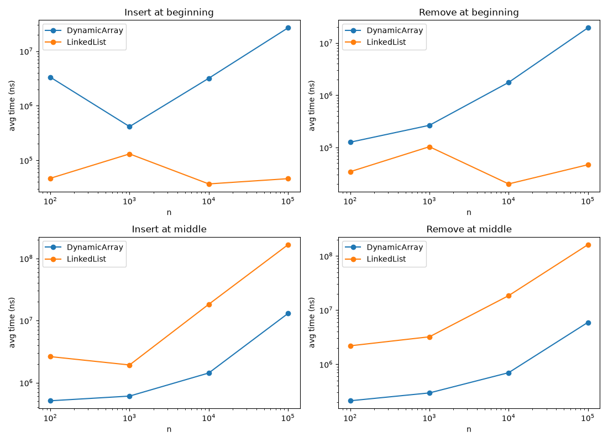
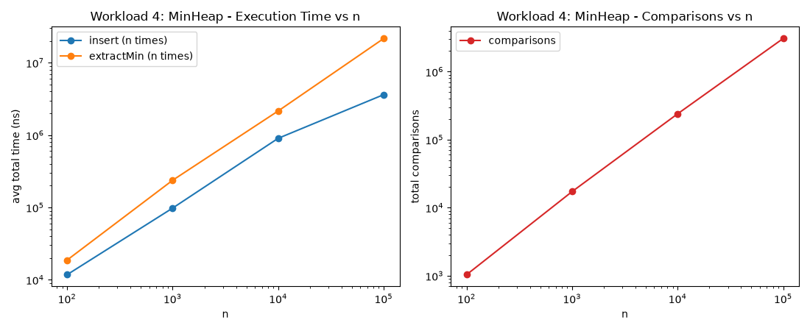

# Assignment 2 — Algorithmic Analysis, Correctness and Performance Trade-offs

## 1. Overview

This project implements a Dynamic Array, a Linked List, and a Min-Heap in Java. It tests the
required operations, explains how they work, and compares their theoretical costs with measured
results.

Benchmarks use OpenJDK 25.0.1, `System.nanoTime()`, fixed random seeds, and five runs per result.
The CSV tables are in `results/tables/`; the plots are in `results/plots/`.

## 2. Complexity Analysis

### Dynamic Array

| Operation | Best | Average | Worst | Auxiliary Space |
|---|---|---|---|---|
| add(x) | Θ(1) | Θ(1) amortized | O(n) (on resize) | O(n) temporarily on resize; O(1) otherwise |
| add(index, x) | Ω(1) (index = end) | Θ(n) | O(n) (index = 0 or resize) | O(n) temporarily on resize; O(1) otherwise |
| remove(index) | Ω(1) (index = end) | Θ(n) | O(n) (index = 0) | O(1) |
| get(index) | Θ(1) | Θ(1) | Θ(1) | O(1) |
| contains(x) | Ω(1) (first element) | Θ(n) | O(n) | O(1) |

Array access uses an index directly, so `get` takes constant time. Appending is usually constant
time; when the array is full, it copies its elements into a larger array, so that single append
takes O(n) time and temporary space. Over many appends, the average cost is Θ(1). Inserting or
removing at an index shifts the elements after that position, so work is smallest at the end and
largest at the beginning.

### Linked List (singly linked, with tail pointer)

| Operation | Best | Average | Worst | Auxiliary Space |
|---|---|---|---|---|
| add(x) | Θ(1) | Θ(1) | Θ(1) | O(1) |
| add(index, x) | Ω(1) (index = 0) | Θ(n) | O(n) (index = size) | O(1) |
| remove(index) | Ω(1) (index = 0) | Θ(n) | O(n) (index = size - 1) | O(1) |
| get(index) | Ω(1) (index = 0) | Θ(n) | O(n) (index = size - 1) | O(1) |
| contains(x) | Ω(1) (first element) | Θ(n) | O(n) | O(1) |

The list keeps both `head` and `tail`, so appending is Θ(1). To reach another index, it follows
links from the head one node at a time. That makes indexed access and middle changes Θ(n) on
average; adding or removing at the front is Θ(1).

### Min-Heap (array-backed binary heap)

| Operation | Best | Average | Worst | Auxiliary Space |
|---|---|---|---|---|
| insert(x) | Ω(1) (new value is largest, no sift) | Θ(log n) | O(n) (on resize) | O(n) temporarily on resize; O(1) otherwise |
| peekMin() | Θ(1) | Θ(1) | Θ(1) | O(1) |
| extractMin() | Ω(1) (heap size 0 or 1) | Θ(log n) | O(log n) | O(1) |

The heap stores the minimum at its root, so `peekMin` is Θ(1). `insert` moves a value up the tree
when needed; `extractMin` moves the last value down. Each sift follows the tree height, which is
O(log n). A single insert can take O(n) if the backing array must grow, but without resizing it
takes O(log n).

The same operation can cost different amounts on different structures: array `get` is Θ(1), while
list `get` is Θ(n). Front insertion is Θ(n) for the array because it shifts values, but Θ(1) for
the list because it changes the head link.

## 3. Correctness — Loop Invariant Proofs

### Proof 1: `DynamicArray.add(index, x)` (insertion via right-shift)

```java
for (int i = size; i > index; i--) {
    data[i] = data[i - 1];
}
data[index] = x;
```

**Invariant:** At the start of each loop, all original values to the right of `i` have been
shifted one place right. Values at positions `0` through `i` are still unchanged.

**Initialization:** At the first loop, `i` equals `size`. Nothing has been shifted yet, so the
invariant is true.

**Maintenance:** The loop copies the value at `i - 1` into position `i`, then decreases `i`. This
extends the shifted section by one place and preserves the invariant.

**Termination and correctness:** The loop stops at `index`. All original values from that position
onward have moved right by one. The final assignment puts `x` at `index`, which is exactly the
requested insertion.

### Proof 2: Heap insertion (`siftUp`)

```java
while (index > 0) {
    int parent = (index - 1) / 2;
    if (data[index] >= data[parent]) break;
    int temp = data[index];
    data[index] = data[parent];
    data[parent] = temp;
    index = parent;
}
```

**Invariant:** At the start of each loop, the heap is valid except that the new value at `index`
may be smaller than its parent.

**Initialization:** The new value is added at the end, where it has no children. The old heap was
valid, so only the new value's parent relation can be wrong.

**Maintenance:** If the new value is not smaller than its parent, no violation remains and the
loop stops. Otherwise, the two values are swapped. The smaller new value moves up; the old parent
moves down and still fits above its children. Any possible violation is now one level higher, so
the invariant remains true.

**Termination and correctness:** Each swap moves `index` closer to the root, so the loop ends
after at most the tree height, O(log n), steps. It ends at the root or when the parent is no
greater than the current value. Every parent is then no greater than its children, so the heap
property holds throughout the heap.

The `Tests` runner also covers empty and singleton structures, duplicates, boundary and invalid
indices, and 50,000-element inputs. Seeded operation sequences are compared with `ArrayList`,
`java.util.LinkedList`, and `PriorityQueue`; the current run passes all 69 checks.

## 4. Experimental Setup

- **n** (elements initially stored): 100, 1,000, 10,000, 100,000
- **m** (operations per workload): 10,000 gets (Workload 1), 1,000 searches (Workload 2),
  1,000 insertions + 1,000 removals at two positions (Workload 3), n inserts + n extracts
  (Workload 4)
- **Repetitions:** every timed measurement is the average of 5 runs
- **Timing:** `System.nanoTime()`, wrapped tightly around only the operations being measured
  (input generation happens before the timer starts)
- **Random seed:** `Random(42)` for building the data structures' contents; separate fixed seeds
  (43 for access indices, 44 for search values) so that index/search generation does not
  accidentally correlate with the data itself
- **JVM warm-up:** a short warm-up pass exercises every operation once before any measurement is
  taken, to reduce JIT compilation noise in the results

To compile, test, and rerun the experiments from the project root in PowerShell:

```powershell
New-Item -ItemType Directory -Force out
javac -d out src\*.java
java -cp out Tests
java -cp out Benchmark
python -m pip install matplotlib
python plot_results.py
```

The benchmark overwrites the CSV files in `results/tables/`; the plotting script regenerates the
images in `results/plots/`.

## 5. Results

### Workload 1 — Random Access (`get`)

| Structure | n | avg time (ns) | total accesses | theoretical per get |
|---|---|---|---|---|
| DynamicArray | 100 | 404,420 | 10,000 | O(1) |
| LinkedList | 100 | 1,773,780 | 502,068 | O(n) |
| DynamicArray | 1,000 | 109,580 | 10,000 | O(1) |
| LinkedList | 1,000 | 12,070,700 | 4,953,268 | O(n) |
| DynamicArray | 10,000 | 313,300 | 10,000 | O(1) |
| LinkedList | 10,000 | 109,870,640 | 49,618,268 | O(n) |
| DynamicArray | 100,000 | 11,900 | 10,000 | O(1) |
| LinkedList | 100,000 | 1,295,374,820 | 493,288,268 | O(n) |



### Workload 2 — Search (`contains`)

| Structure | n | avg time (ns) | total comparisons | theoretical per search |
|---|---|---|---|---|
| DynamicArray | 100 | 111,300 | 100,000 | O(n) |
| LinkedList | 100 | 449,940 | 100,000 | O(n) |
| DynamicArray | 1,000 | 959,960 | 999,496 | O(n) |
| LinkedList | 1,000 | 3,130,120 | 999,496 | O(n) |
| DynamicArray | 10,000 | 5,946,660 | 9,950,295 | O(n) |
| LinkedList | 10,000 | 30,991,160 | 9,950,295 | O(n) |
| DynamicArray | 100,000 | 64,557,140 | 95,206,221 | O(n) |
| LinkedList | 100,000 | 457,906,660 | 95,206,221 | O(n) |



### Workload 3 — Insertion and Removal

Full table in `results/tables/workload3_insert_remove.csv`. Representative rows at the two
extremes:

| Structure | Operation | Position | n | avg time (ns) | movements |
|---|---|---|---|---|---|
| DynamicArray | insert | beginning | 100,000 | 26,659,440 | 100,600,500 |
| LinkedList | insert | beginning | 100,000 | 46,020 | 1,000 |
| DynamicArray | insert | middle | 100,000 | 12,965,320 | 50,600,500 |
| LinkedList | insert | middle | 100,000 | 165,602,900 | 50,000,000 |
| DynamicArray | remove | beginning | 100,000 | 19,459,320 | 100,499,500 |
| LinkedList | remove | beginning | 100,000 | 46,740 | 0 |



### Workload 4 — Priority Processing (Min-Heap)

| n | avg insert time (ns) | avg extract time (ns) | total comparisons | theoretical batch complexity | order valid |
|---|---|---|---|---|---|
| 100 | 11,760 | 18,720 | 1,035 | O(n log n) worst case | true |
| 1,000 | 97,900 | 237,360 | 17,226 | O(n log n) worst case | true |
| 10,000 | 901,920 | 2,152,960 | 239,329 | O(n log n) worst case | true |
| 100,000 | 3,621,620 | 21,612,300 | 3,059,125 | O(n log n) worst case | true |

The n insertions and n extractions each have O(n log n) total worst-case time; their combined
comparison count is O(n log n). `extractMin()` returned elements in non-decreasing order at every
n.



## 6. Discussion

**How does larger n affect the work?** Array random access stays at 10,000 counted accesses.
Linked List random access and both structures' search comparisons grow with n. Beginning changes
stay cheap for the Linked List, while middle changes require traversal or shifting. Heap comparison
counts grow close to n log n.

**Do the results match the theory?** The operation counts mostly do. Timing is less predictable:
JVM startup, warm-up, and system activity can affect short measurements. In particular, the array
random-access times vary, so its fixed access count is better evidence of Θ(1) than the timings.

**Why do similar Big-O operations take different time?** Arrays store values together in memory,
which makes scanning efficient. Linked Lists follow pointers between separately allocated nodes.
These layout and allocation costs change real running time even when both operations are O(n).

**Which structure should I choose?** Use a Dynamic Array for indexed reads and scanning. Use a
Linked List when changes are mostly at the front. Use a Min-Heap when the smallest value must be
processed repeatedly. The best choice depends on the operations the workload performs most often.

## 7. Design Recommendations

| Workload pattern | Recommended structure | Why |
|---|---|---|
| Frequent random indexed reads | Dynamic Array | O(1) get, cache-friendly |
| Frequent search by value, rare structural changes | Dynamic Array | Same O(n) as list, lower constants |
| Frequent insert/remove at the front | Linked List | O(1) vs. O(n) shifting |
| Frequent insert/remove at arbitrary/middle positions | Either (workload-dependent) | Both O(n); array usually faster due to locality |
| Always need the current minimum | Min-Heap | O(log n) insert/extract vs. O(n) scan-for-min |

## 8. Conclusion

The measurements mostly match the operation counts predicted by the complexity analysis. Real
running time also depends on memory layout and the operations a workload performs. Choose the data
structure whose fast operations best match that workload.
